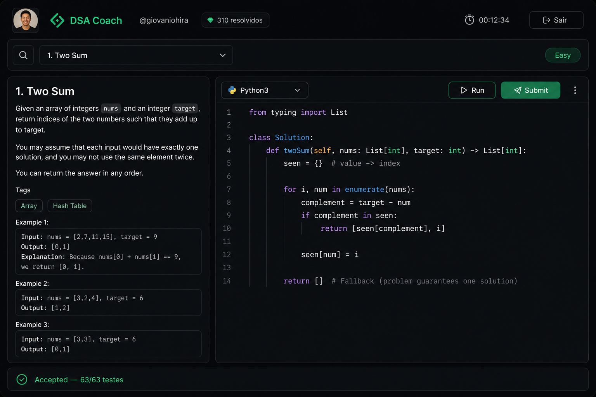

# DSA Coach

App desktop (Electron + React + TypeScript) para treinar entrevistas técnicas como se fossem de verdade: escolhe o problema, liga o timer, resolve em Python no Monaco e submete direto no LeetCode, tudo sem sair do app.



## Recursos

- **Login no LeetCode** numa janela própria (partition `persist:leetcode`). O cookie de sessão fica cifrado com o `safeStorage` do Electron e nunca é salvo em texto puro.
- **Picker de problemas** com catálogo local sincronizado (`npm run sync-problems`). O catálogo não vai para o repo.
- **Editor Monaco** com tokenizer Python e tema próprios.
- **Submissão e resultado do juiz** (Accepted, WA, TLE, runtime/memória) via GraphQL do LeetCode (`leetcode-query`).
- **Timer de entrevista** e gravação de sessão: cada tentativa vira um evento em SQLite (`better-sqlite3`), base para estatísticas de evolução.
- Janela frameless com title bar e controles próprios.

## Arquitetura

```
src/main       processo principal: auth, IPC, SQLite, adapter do LeetCode
src/preload    ponte tipada (contextBridge)
src/renderer   UI em React (picker, editor, timer, resultado)
scripts        sync do catálogo e self-check do adapter
```

## Rodando

```bash
npm install
npm run sync-problems   # baixa o catálogo para data/ (ignorado no git)
npm run dev
npm run check           # self-check do adapter
```

Projeto pessoal, sem afiliação com o LeetCode.
